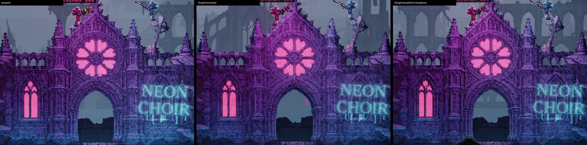
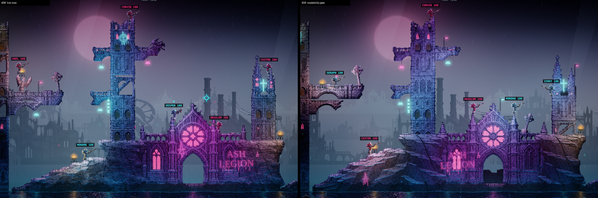

# Readability pass (16 Nov 2026)

Why the 15–16 Nov art refresh looked worse in game than it did as sprites, what we changed, and the bar every piece now has to meet. Written by Claude for Jarred and ChatGPT. Art direction overall: [`ART-DIRECTION.md`](ART-DIRECTION.md).

## What went wrong

ChatGPT redrew about 45 kit pieces, rocks and statues: more depth, a Back layer, and most at 2× density. As sprites they're impressive. In game, the towers, bridges and cathedral front read as grain ("like a Geiger image"); the old ones had clear detail and strong lines when zoomed out. We shipped 23 of them, then rolled them back the same night (GV 71).

There were three separate problems.

### 1. Noisy Height maps (the grain and the doubled edges)
The lit look turns the Height into surface relief. The new Heights were full of salt-and-pepper speckle: 10–36% of pixels on the structural pieces differ sharply from their neighbours, against under 2% on the rocks. Every speckle catches light as a tiny bump, which is the grain. And every edge already painted into the Body gets a second highlight-and-shadow pair from the relief, which is the doubled, ghosted edge Jarred saw on the towers. The Heights were aligned (zero offset); the noise was the problem.

Most first-pass Heights also just copy the drawing's brightness (0.95–0.99 correlated). The shader already uses brightness as relief when a piece has no Height, so those add nothing but noise.

### 2. Too much detail for the size it's drawn at
At 2× density, the structural pieces change colour between neighbouring game pixels 34–54% of the time. The old 1× bridge Jarred liked (K05d) sits at 26%; rocks at 5–18%. Fine tracery and mortar everywhere, with no big shapes to hold it, turns to texture when zoomed out. It also clashes with the procedural terrain, which the game draws at 1× with a few flat tones.

Higher resolution isn't the problem in itself. The fallen arch (K12) and dome (K13) work because the detail sits inside big, clear forms. Detail density is.

### 3. Back showing through windows
On the towers and belfry, the Back layer fills window openings with more facade (K10 and K11: about 70,000 pixels of Back visible through holes; K08 about 20,000). Windows should show a dark interior or a lit glow, not more wall. **Manual fix in the art.**

## What we changed (not live yet)

*Superseded the same day: Jarred prefers the original drawings. See the bar below. The halved redraws stay in the Library.*

Saved as new Library versions on `art/weapon-lab` (16 Nov). Try them on the test page (Grimspire TEST: readability pass).

- **All 30 structural kit pieces** (K01–K17 with variants): back to 1× density with `simplify.py`. Each 2×2 block is averaged and snapped back to the piece's own six tones, so texture becomes flat planes; stray pixels are cleaned. Same game size, same silhouettes, Back kept. Detail drops by about half (cathedral front 0.50 → 0.28, belfry 0.38 → 0.23, bridges 0.37–0.49 → 0.20–0.28).
- **Every noisy Height** (all structural pieces, K05d, K12, S01, S03, S07): rebuilt with `height_punch.py` as six flat depth planes from a median-smoothed base, so forms catch light and texture doesn't. Speckle drops from 10–36% to 3–8% (what's left is plane edges).
- **Statues S01, S03, S07**: halved the same way (S03 and S07 with a stronger cleanup). They now sit close to the S01 standard below.
- **Unchanged**: rocks R01–R11 and S09 (already clean), K13 (already clean), K12's drawing (Height only).

Known leftovers: windows still show Back (above); bridge ends on K05 and K05c are open apart from the deck (ChatGPT's redraw); statues are still a little busier than S01.

## The bar

**Benchmark (Jarred, 16 Nov): the original K08 cathedral front.** Strong, heavy lines and a scannable shape. That's the asset style we aim for, with better Height and Back layering on top. Jarred still prefers it to both the 2× redraw and the halved redraw. The original S01 fallen saint head is the benchmark for statues.

**Direction:** keep the original kit drawings. Improve them with clean Heights (depth planes) and Back layers. Don't redraw them. **Correction (16 Nov, later):** the original kit's Heights (11 Nov, relief 4) are fine as they are. What the speckle measure flagged on them is mostly real detail (mortar lines, step edges). Rebuilding them as flat planes erased the brick and blew top surfaces out to white blobs, so don't run `height_punch.py` plane mode on the originals. The grain problem was specific to the 2× redraw Heights. The test page baseline is the original kit with its original Heights.

**Also reference: the original S01 fallen saint head.** Chunky pixels at 1× density, about six tones in flat blocks, a strong silhouette, shading by planes rather than gradients. Push it slightly further with more separation between overlapping forms (a lighter rim or a tone step where the halo meets the rubble).

Every piece:
- **Judged at play zoom, next to the terrain**, before anything ships. Not as a sprite on its own.
- **Smallest visible feature about 2 game pixels.** No crack, mortar line or tone change smaller than that.
- **5–7 tones per material** (up to about 10 on a statue face). Flat clusters, no painted gradients or per-pixel noise.
- **Big forms first.** Spend detail where it earns attention (a face, a rose window, a doorway), not as an even texture.
- **Height as depth planes**: front ribs and piers high, wall faces middle, recesses low. Smooth within each plane. No speckle, and not a copy of the drawing's brightness.
- **Openings**: Back behind a window or door is dark interior or lit glass, never more facade.
- **Same tone ramp as the kit**: dark navy stone (masonry body mean about RGB 28/34/43, rock about 40/47/58).

Two tiers:
- **Kit pieces** (shafts, bridges, walls, spires, piers): 1× density, the most restraint. They tile and touch the terrain constantly.
- **Landmarks** (the arch, dome, colossal heads, whole-level set pieces): higher resolution allowed, still on the tone budget, big forms first. Rare and the "wow" moment.

## Measuring it

Numbers Claude checks on every release (scripts in `/art/lab/tools/`):
- **Detail at play zoom**: share of neighbouring game pixels whose brightness differs sharply. Kit pieces about 0.15–0.28; above 0.35 reads as grain.
- **Height noise**: share of Height pixels that differ sharply from their 3×3 median. Under about 0.2 is fine when the variation is lines (mortar, edges); judge by eye at play zoom, not by this number alone. `height_punch.py --despeckle` removes only isolated speckle and keeps lines.
- **Tone count**: 5–10 per piece.

## Tools

On `art/weapon-lab`, `art/lab/tools/`:
- `simplify.py`: halve a 2× piece's detail (back to 1×, requantised flat planes, stray-pixel cleanup).
- `height_punch.py`: rebuild a Height as smooth depth planes (`--flatten 2 --levels 6 --curve 1.2 --detail 0 --stretch 60 200` was the setting used).
- `pixel_snap.py`: snap a painterly piece to a kit tone ramp (first trial on the statues; `simplify.py` replaced it for this pass).

## Asks for ChatGPT

1. Stop 2× density on kit pieces, and stop redrawing them. Work from the original 1× drawings: add Back layers and depth-plane Heights to those. Landmarks can go higher.
2. Heights as smooth depth planes, never speckle or a brightness copy.
3. Back behind every window and door opening: dark interior or lit glass.
4. Before saving, look at the piece at play zoom next to terrain.
