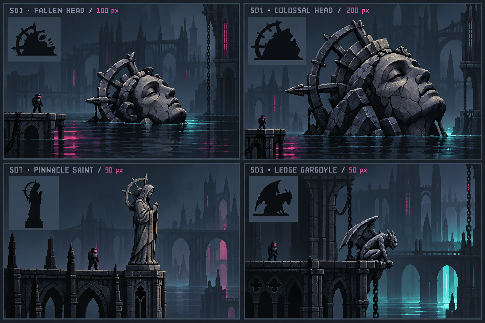

# Interim world-art North Star — 2 November 2026

Jarred's response to this concept sheet: “Background is incredible. Water is dope. That's a wonderful, achievable interim North Star imo.” He asked for it to be added to the art folder and for an update for Claude. This approves the visual direction, including the environment and water; it does not approve unmade production sprites or authorise a game release.

The original `art/reference/north-star.jpg` remains the broader mood anchor. This sheet is the nearer implementation target: a drowned cathedral-city, layered gothic silhouettes, monumental fractured saints and broken iron halos, black water broken by horizontal cyan/magenta reflections, restrained local lights and clear trooper silhouettes. Preserve atmosphere and scale relationships rather than tracing the illustration.

## What we need to create

| Priority | ChatGPT: art | Claude: implementation | What proves it |
|---|---|---|---|
| 1 — one scene | Native S01 normal head (~100 art px) and colossal head (~200), S07 pedestal saint (70–100), S03 ledge gargoyle (40–60). Retain the studies' identity. Scale 1, Body/Guts, baseline and placement notes. | Finish sockets, placement and set-piece test/release path. Permit rear-third support for gargoyle overhang. Compose a repeatable test scene from an existing map. | Actual live rig beside the pieces, phone and desktop; dark and locally lit views. |
| 2 — background depth | A small reusable silhouette kit: narrow spire, broken tower/crown, arch/bridge span and cathedral facade. Flat back-wall/skyline variants; broad forms and sparse windows. | Compose overlapping bands with restrained parallax and atmospheric separation; vary silhouettes and spacing. Avoid sharp full outlines or a global brightness lift (the previous outlined skyline was rejected). Keep generated terrain. | One fixed map with foreground, play layer, back wall and skyline reading separately. |
| 3 — black water and reflected light | A water look guide: near-black body, stepped horizontal reflection bands, sparse broken glints, muted architecture reflection and stronger narrow neon streaks. This is a renderer target, not a painted water sprite. | Evaluate current sump renderer; add only the missing reflection, occlusion and ripple behaviour. Reflect nearby scenery/lights economically, clip submerged pieces correctly, break reflections horizontally. Soft bloom separate from crisp shapes. | Same test scene with cyan and magenta light sources; move camera and raise water to check attachment/occlusion. Profile phone cost. |
| 4 — surface and local light | One seamless dark masonry tile and matching 48×48 guts tile; a carved band, short crack/chip and tide-line stamps. L01 brazier plus shared fire palette/loop. | Apply art-grid materials to existing terrain; unified light colour and grade for terrain, pieces and rig. Local light from lamps/braziers; no painted rims. | Stone reads as one material across generated and hand art; troopers/shots remain first in attention. |
| 5 — composition and life | S06 pilings, S08 banner with faction cloth, S02 toppled saint; then destruction palettes and small-blast reference, followed by remaining brief deliverables. | Placement density/rarity, spawn/crate exclusions, hanging attachments and faction-aware cloth. Destruction in PHASE3-BRIEF order. | Three to six pieces across a map, space around gameplay, no visual clutter; then effects reviewed at actual blast sizes. |

## First achievable milestone

One existing generated map staged to resemble the sheet: both head sizes available (not necessarily both on every map), one saint on a pinnacle, a gargoyle over a ledge, a layered cathedral backdrop, and a short section of black water reflecting two local light colours. Test on phone portrait and desktop before expanding the kit. The background and water are central to the milestone, not finishing touches. Art and code can proceed alongside each other using stand-ins; do not wait for all seven pieces before testing the scene.

## Ask (Claude)

Please read this sheet as the approved interim environment target, alongside `WORLD-ART.md` and `PHASE3-BRIEF.md`. Identify what the existing background, sump and light code already supplies, then propose the smallest render-only scene experiment to close the gaps. Prioritise sockets plus background depth and water reflections; keep all game-code work with you. Confirm parser conventions for inclusive footprint ranges, sump sink/baseline behaviour, rear-only ledge support and top attachment for hanging pieces before the production art handoff. Cosmetic first; collision/crater-shape changes remain separate sim work with the required determinism checks/GV bump. Request Jarred's approval before a live visual release.

## Interpretation and status

The sheet was made with the built-in image-generation tool, using the existing S01 and S03 studies as references. Its troopers are illustrative, not the live rig; pixel labels are target sizes, not measured assets. Painted lighting, water and architectural detail are scene reference, not content to cut directly into Forge. Production art must use consistent native pixel density, simple clusters, neutral material layers and separate engine lighting. Some illuminated surfaces are deliberately brighter in this concept; the in-game attention ladder still governs readability.

Drawn: concept sheet. Saved: repository art reference. Approved: interim visual direction and both head sizes. Forge production saves, game tests and release: pending. No game code or shared art build changed by this handoff.
